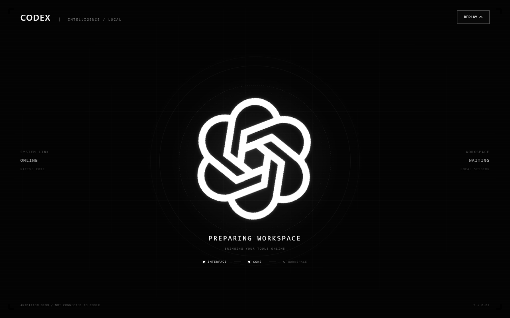

# Codex Startup animation

**让 Codex 的枯燥启动等待，变成一次炫酷的系统启动。**

面向 Windows Codex 桌面端的启动动画。

[快速开始](#快速开始) · [使用方式](#使用方式) · [自定义动画](#自定义动画) · [测试与验证](#测试与验证) · [参考与致谢](#参考与致谢)



## 功能特点

- **完整的 AI 入口动效**。
- **启动状态同步**：INTERFACE、CORE、WORKSPACE 节点对应实际检测结果；原生完成和界面稳定后自动退出动画。
- **随时跳过**：Skip 按钮和 Esc 可退出动画；超时或探测失败时同样释放覆盖层。
- **保留正常启动**：项目启动项与官方原本启动项独立，无需担心版本更新后工具不兼容导致软件无法启动。
- **本地资源**：动画运行时无需下载字体、图片或音频，不需要 API key。
- **可自定义动画**：可修改代码自定义自己喜欢的启动动画。

## 环境要求

| 项目 | 要求 |
| --- | --- |
| 系统 | Windows |
| Node.js | 22 或更高版本 |

## 快速开始

### 1. 获取并放置项目

通过 Git 获取源码。

在该目录打开 PowerShell，确认 Node.js 已安装：

```powershell
node --version
```

### 2. 生成本机快捷方式

快捷方式保存绝对路径。首次获取项目，或移动整个项目目录后，请重新生成：

```powershell
powershell.exe -NoProfile -ExecutionPolicy Bypass -File .\tools\create-shortcut.ps1
```

项目目录会生成 **`Codex.lnk`**，图标为黑底白色 ChatGPT 标识。可将此快捷方式复制到桌面；图标资源位于 `embedded/assets/codex-startup.ico`，请保留原文件。

### 4. 启动

保存工作并**完整退出当前 Codex**，再双击 `Codex.lnk` 或 `Start Codex.cmd`。

## 使用方式

项目启动入口为：`Start Codex.cmd`。

| 操作 | PowerShell 命令 | 行为 |
| --- | --- | --- |
| 动画启动 | `& '.\Start Codex.cmd'` | 校验版本，启动 Codex，并接入动画 |
| 普通启动 | `& '.\Start Codex.cmd' --normal` | 通过系统正常激活应用，不注入动画 |
| 独立预览 | `& '.\Start Codex.cmd' --preview` | 浏览器打开本地演示，可重复播放 |
| 只读检查 | `& '.\Start Codex.cmd' --check` | 检查版本、运行进程和端口状态 |

## 自定义动画

拟可以通过修改源码来自定义自己的动画。

| 内容 | 文件 |
| --- | --- |
| 配色、背景、布局、旋转速度、光效与关键帧 | `embedded/mono-overlay.template.html` |
| 素材 | `embedded/assets/chatgpt-knot.svg` |
| 启动过程的英文阶段文案 | `embedded/presentation.mjs` |
| 成功揭幕文案与释放行为 | `embedded/overlay.js` |
| 快捷方式与图标生成 | `tools/create-shortcut.ps1` |

## 项目结构

```text
.
├── Start Codex.cmd         # 启动工具
├── Codex.lnk               # 用户本机生成的启动快捷方式
├── embedded/               # 接入控制器、适配器、就绪策略、动画与图标
├── preview/                # 独立演示页面
├── tools/                  # 构建、快捷方式与打包工具
├── docs/images/            # README 演示图片
└── .neon-runtime/          # 本机调试资料与日志，不纳入版本控制
```

## 参考与致谢

本项目的形成得益于以下两个开源项目的公开实践，感谢原作者与贡献者：

| 参考项目 | 作者 | 对本项目的贡献与启发 |
| --- | --- | --- |
| [dsh-startup-screen](https://github.com/6shenhonghong9/dsh-startup-screen) | [6shenhonghong9](https://github.com/6shenhonghong9) | 提供了将启动等待设计成分阶段系统进入体验的参考，包括标识亮相、阶段提示、揭幕、跳过和独立预览，启发了本项目最初的启动动画方向。 |
| [Codex-Dream-Skin](https://github.com/Fei-Away/Codex-Dream-Skin) | [Fei-Away](https://github.com/Fei-Away) | 提供了通过本机回环 CDP 在真实 Codex 界面中实现视觉定制的技术参考，帮助本项目从外置动画探索转向页面内覆盖层接入。 |

## 许可证与标识

项目代码采用 [MIT License](LICENSE)。ChatGPT、Codex、OpenAI 名称及相关标识的权利属于其各自权利人，代码许可不授予这些标识的使用权。本项目与 OpenAI 无官方隶属或背书关系。

